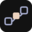

# Visual identity

**Prompt Chaining Studio · Brand reference · November 12, 2026**

Three connected stages make the handoff visible. The solid middle stage draws attention to the answer a person can inspect or change before it goes forward. Use the same identity for Studio, Classroom Challenges, and Workbench. The surface, example, and audience descriptor tell readers which experience they are looking at.

## Logo system

| Application | Artwork | Treatment |
| --- | --- | --- |
| Dark website, slide, or video | [Full lockup](assets/studio-wordmark-dark.svg) · [Mark](assets/studio-mark-dark.svg) | Warm wordmark and center stage, with periwinkle links and outer stages |
| Light document, handout, or slide | [Full lockup](assets/studio-wordmark-light.svg) · [Mark](assets/studio-mark-light.svg) | Ink wordmark and center stage, with indigo links and outer stages |
| One color on a dark surface | [Full lockup](assets/studio-wordmark-mono-dark.svg) · [Mark](assets/studio-mark-mono-dark.svg) | White |
| One color on a light surface | [Full lockup](assets/studio-wordmark-mono-light.svg) · [Mark](assets/studio-mark-mono-light.svg) | Near-black |
| Square avatar or favicon | [Tiled icon SVG](assets/studio-icon.svg) · [512 px PNG](assets/studio-icon-512.png) · [32 px PNG](assets/studio-icon-32.png) | Dark tile with the two-color mark |
| Document or slide editor with limited SVG support | [Dark-surface PNG](assets/studio-wordmark-dark.png) · [Light-surface PNG](assets/studio-wordmark-light.png) | Transparent 3× lockup exports |

- **First appearance.** Use the full lockup in the opening frame or page header. Use the standalone mark in an avatar, a favicon, or where the full name already appears as live text.
- **Clear space.** Keep one solid center stage of space beyond the visible artwork on all four sides. The center stage is 17 units high in the 64-unit master. For a 32 px mark, allow at least 8.5 px from the outermost ink to an adjacent graphic or crop.
- **Minimum sizes.** Start at 220 CSS px or 58 mm wide for the full lockup, and 24 CSS px or 6 mm for the mark. Prefer 28–32 px for navigation icons. Use the supplied 32 px tile in browser and shortcut contexts where available. Check the destination at actual size.
- **Placement.** Place the logo on an even fill and use the artwork for that surface. With photos or busy textures, set the logo on a solid plate with the same clear space. Maintain its proportions and reading direction. Avoid outlines, shadows, gradients, rearranged stages, and recreated lettering.
- **Descriptors.** Set “Classroom Challenges” or “Workbench” as live text alongside or below the Studio lockup when useful. Use the same treatment for Guide, Example, or other descriptive titles. Avoid individual product marks and colored badge systems.
- **Text alternative.** Use `alt="Prompt Chaining Studio"` for an image that supplies the brand name. When adjacent live text supplies the same name, give the image empty alt text. For a standalone home link, give the link an accessible name such as “Prompt Chaining Studio home.”

The outlined lettering uses Bricolage Grotesque at weight 700. The logo and social artwork render independently of installed fonts. [Bricolage Grotesque project and license](https://github.com/ateliertriay/bricolage)

## Color

The application uses [Candlelight CSS](../../server/static/candlelight.css). Use its dark foundation for product imagery and Workbench material. The Paper companion palette is for classroom print, slides, and light marketing surfaces. Dark functional colors supplement the branding specification where a visible boundary or subdued text is needed.

| Role | Candlelight | Paper | Application |
| --- | --- | --- | --- |
| Page | `#121212` | `#F8F1E8` | Main field or page |
| Surface | `#1A1A1A` | `#FFFAF5` | Prompt, lesson, or run panel |
| Raised surface | `#242424` | `#EAE7F5` | Reused text, current step, or nested panel |
| Text | `#EBD2BE` | `#242424` | Heading, label, and body |
| Secondary text | `#B9AEA4` | `#594E47` | Helpful context and captions |
| Action and links | `#A6ACCD` | `#4C548C` | Link, primary action fill, or visible connection |
| Text on action fill | `#121212` | `#F8F1E8` | Primary button label |
| Focus | `#D9DCF2` | `#4C548C` | Outline with visible space from control edge |
| Functional border | `#7B7481` | `#786E68` | Input or state boundary when it identifies a control |
| Decorative divider | `#403B46` | `#D7CBBE` | Optional rule between independently labeled regions |

For Candlelight status copy, pair `#98C379` with “Saved,” `#F59E0B` with a specific attention message, and `#E06C75` with a specific error. Use a label and, where helpful, an icon with each status. In Paper layouts use ink status text and explicit labels. Reserve the app’s `#6B7280` for decorative detail in new assets. Use secondary text for captions and instructions.

### Contrast pairs

Ratios below use solid sRGB hex values and are rounded for display. Check contrast at the point of use when an overlay, transparency, print substrate, or image changes the background. Aim for 4.5:1 for essential copy, including small labels. Aim for 3:1 where a boundary, focus indicator, or graphical element communicates a control, state, or relationship. These measurements cover specific color pairs. Product accessibility requires interaction and assistive-technology evaluation. [W3C text contrast](https://www.w3.org/WAI/WCAG22/Understanding/contrast-minimum.html) · [W3C non-text contrast](https://www.w3.org/WAI/WCAG22/Understanding/non-text-contrast.html)

| Tested pair | Ratio |
| --- | ---: |
| Candlelight text on page / raised | 12.93:1 / 10.71:1 |
| Candlelight action on page / raised | 8.39:1 / 6.95:1 |
| Candlelight secondary on raised | 7.14:1 |
| Candlelight focus on raised | 11.44:1 |
| Candlelight functional border on raised | 3.44:1 |
| Paper ink on page | 13.85:1 |
| Paper secondary on page | 7.19:1 |
| Paper action on page / raised | 6.34:1 / 5.84:1 |
| Paper functional border on raised | 4.08:1 |
| Dark status green / amber / red on raised | 7.70:1 / 7.23:1 / 4.86:1 |

## Type and hierarchy

The Studio uses local font fallbacks. The recommended editable typography below follows its serif-heading, sans-body, and mono-syntax pattern. Use the first installed family in each row. For exchange documents choose available fonts in the document editor and check the result on its target platform. The outline assets travel independently.

| Role | Preferred stack | Starting settings |
| --- | --- | --- |
| Marketing or guide title | Fraunces, Iowan Old Style, Palatino, Georgia, serif | 600 weight, 36–64 px, line height 1.1 |
| Section title | Same serif or the body family | 600–700, 24–36 px, line height 1.2 |
| Body and interface text | Manrope, Avenir Next, Segoe UI, system-ui, sans-serif | 400–500, 16–18 px, line height 1.55–1.65 |
| Student directions | Body family | 500, 18–20 px digital or 13–14 pt on handouts, line height 1.55 |
| Action, label, caption | Body family | 600–700, 14–18 px, sentence case |
| Commands and literal variables | IBM Plex Mono, SFMono-Regular, Consolas, monospace | 400–500, 0.95–1 em, allow wrapping or give an explicit scroll area |

Use 24 px or larger for essential text on projected slides and check it from the back of the room. Give example answers and user-entered text the same reading hierarchy as surrounding prose. Keep paragraphs around 50–70 characters per line. Preserve line spacing and margins when layouts narrow or type scales up.

## Composition by experience

**Studio.** Open with a headline, short description, and one labeled example. A two-column spread can put the promise beside the handoff. At narrow widths, put headline, description, action, and example in that reading order. Use the mark as a small identifier and use a real prompt handoff as the illustration.

**Classroom Challenges.** Keep the activity title and current action easy to spot. Give clues their own line breaks. Distinguish “Sample draft,” “Your fix,” and “Next prompt” with live labels and a visible reused passage. When comparing a student answer and an example, show “Your fix” first. Stack comparison panels on narrow screens. On handouts, use the light lockup, generous pencil space, and black type on unprinted stock when printing in black and white.

**Workbench.** Lead with the user’s intent, recipe, or saved progress. Group the current prompt, latest saved answer, and next action. Make it visually clear which action reviews work and which action sends a live request. Put optional model settings, technical detail, and the full trace where users can open them when needed.

### Layout and components

| Element | Visual rule |
| --- | --- |
| Spacing | Use 4, 8, 12, 16, 24, 32, 48, and 64 px. Give separate actions room for touch and keyboard focus. |
| Panels | Use one 12–16 px corner radius in a given layout. Use a single surface change, rule, or gap to separate sections. |
| Actions | Use a filled primary button for the next step, a bordered secondary button for alternatives, and underlined links for reading or navigation. Aim for a 44 × 44 CSS px control area where practical. |
| Focus and state | Retain a persistent, visible focus outline. Keep focus clear of sticky edges. Pair progress color with text such as “Step 1 saved” or “Review step 2.” |
| Icons | Use simple 2 px strokes at 24 px and a visible label for an unfamiliar action. Allow arrows to accompany the action or diagram label. |
| Motion | Keep motion optional and brief. Respect reduced-motion settings. Show the same step, saving, or failure feedback when motion is disabled. |
| Illustration | Prefer an annotated example, a cropped product screen, or a simple real object from the activity. A paper fan, desk, or toy tiger can set a scene while the labels carry the instructions. |

## Depict the handoff

1. Show the starting prompt or clue.
2. Show a sample answer or the learner’s correction in its own panel.
3. Repeat the same excerpt verbatim inside the next prompt, and show the new instruction.
4. Label the reuse in text, for example “The next prompt uses these words.” Connect the matching passages with alignment, an accent field, a rule, or an arrow.
5. Keep the order and labels in the reading sequence. Put important example text in the page, caption, or transcript when an image carries it.

Use app screenshots for a demonstrated interface and label reconstructed examples as illustrations. Use fictional sample inputs, crop away personal paths and settings, and check traces for API keys and private text. If a screenshot needs a zoomed crop, keep the action and its outcome in view or provide a short caption.

## Application assets

| Asset | Preview / use |
| --- | --- |
| Studio sharing image | [PNG](assets/social-studio.png) · [SVG](assets/social-studio.svg). Show the general promise and an illustrated dragon prompt chain. |
| Classroom Challenges sharing image | [PNG](assets/social-classroom.png) · [SVG](assets/social-classroom.svg). Show an adapted Rainy Recess correction. |
| Workbench sharing image | [PNG](assets/social-workbench.png) · [SVG](assets/social-workbench.svg). Show an illustrated decision workflow with saved criteria. |

Start a new card with the [editable SVG template](assets/social-template.svg). All three finished cards are 1200 × 630 px. The 72 px outer margin, 376 px example panel, and 70 px two-line headline form the landscape template. Use a small Studio lockup at the top, an audience descriptor if needed, one headline, two lines of supporting copy, and three labeled stages. For tall or square placements, stack a new layout from the source pieces and prioritize the headline and example over the footer. Put the important words and destination in the accompanying post or page. For caption and export details, see the [asset handoff](assets/README.md).

## Artwork handoff

Use SVG masters for design and high-resolution export. Keep text outside the outlined artwork editable in websites, documents, and slides. PNGs cover social upload and editors that need raster images. The deliverables use sRGB values. For a print vendor, request a proof on the selected stock and convert to the vendor’s requested color profile at final export. These are proposed brand assets for adoption alongside the existing application styling.
